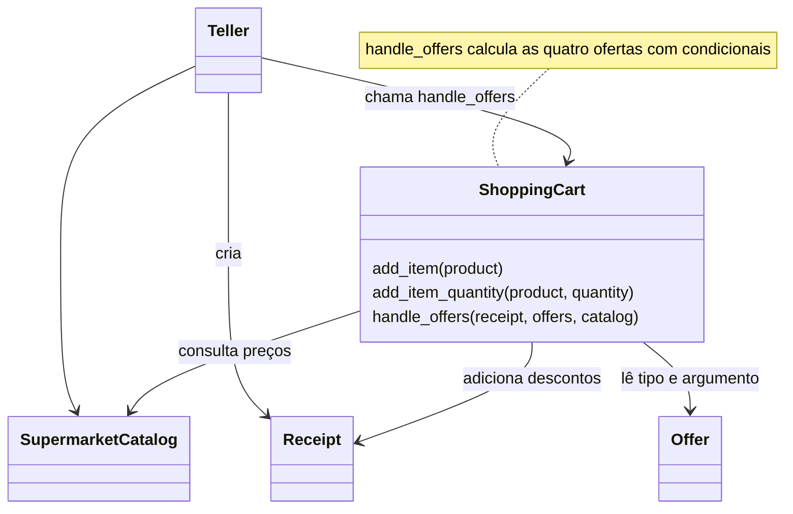
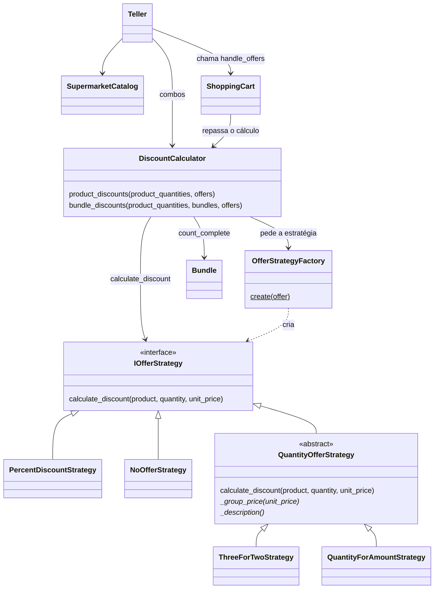

# Decisões técnicas da modernização

Este documento registra o que foi encontrado no código original, o que foi
alterado e por quê. Serve de base para os relatórios de diagnóstico, requisitos,
plano de contingência, padrões de projeto e segurança.

As referências de linha da seção 1 são do **código original** (commit `c72d68a`).
Para ver um arquivo como era: `git show c72d68a:python_pytest/src/shopping_cart.py`.

## 1. Diagnóstico do código original

| # | Problema | Onde (código original) | Efeito |
|---|---|---|---|
| D1 | Método longo, com muitos caminhos condicionais | `src/shopping_cart.py`, linhas 30 a 68, `handle_offers` | Difícil de ler, de testar e de alterar sem quebrar outra oferta |
| D2 | Condicionais por tipo de oferta | `src/shopping_cart.py`, linhas 39, 42, 49, 53, 58 e 62 | Cada oferta nova obriga a editar o mesmo método (fere o princípio Aberto/Fechado) |
| D3 | Responsabilidade no lugar errado: o carrinho calcula descontos | `src/shopping_cart.py`, linhas 30 a 68 | O carrinho passa a ter dois motivos para mudar: guardar itens e regras de promoção (fere o princípio da Responsabilidade Única) |
| D4 | Duplicação: três fórmulas quase iguais para as ofertas por quantidade | `src/shopping_cart.py`, linhas 45-46, 54-55 e 63-64 | Corrigir uma fórmula não corrige as outras. Foi assim que o defeito D7 ficou só em uma delas |
| D5 | Nomes que não explicam o conteúdo | `src/shopping_cart.py`: `p` (31), `x` (38), `discount_n` (46), `number_of_x` (52). `src/teller.py`: `product_quantities` guarda itens (16), `pq` (17), `p` (18) | Leitura lenta e sujeita a erro |
| D6 | Números mágicos | `src/shopping_cart.py`: 3 (40), 2 (43, 44, 45), 5 (50, 62, 64), 2 e 3 (53, 55), 100.0 (60) | A regra de negócio fica escondida em números soltos |
| D7 | Defeito na oferta "2 por valor" com quantidade ímpar | `src/shopping_cart.py`, linha 45: `quantity_as_int / x` | A divisão dá 1,5 par para 3 unidades. O cliente paga mais do que sem a oferta (ver seção 7) |
| D8 | Fração de peso não cobrada nas ofertas por quantidade | `src/shopping_cart.py`, linhas 36, 54-55 e 63-64 | 3,5 kg no "leve 3, pague 2" custam o mesmo que 2 kg. Comportamento mantido e registrado em teste |
| D9 | O caixa depende de um atributo que só existe no catálogo de teste | `src/teller.py`, linha 29, usa `catalog.products`, ausente em `src/catalog.py` | Um catálogo real sem esse atributo quebraria `product_with_name` |
| D10 | Nenhuma anotação de tipo | Todos os arquivos de `src/` | Erros de tipo só aparecem em execução |
| D11 | Quase nenhum teste | `tests/test_supermarket.py`: 1 teste. Cobertura de `shopping_cart.py`: 41% | Não havia rede de segurança para refatorar |
| D12 | Nome de enumeração enganoso | `SpecialOfferType.TEN_PERCENT_DISCOUNT` aceita qualquer percentual (`src/shopping_cart.py`, linhas 58-60) | Mantido, porque o nome faz parte da interface pública |
| D13 | Exceção genérica e mensagem repetida | `src/catalog.py`, linhas 5 e 8 | Tipo da exceção mantido para não alterar o comportamento. A mensagem repetida virou uma constante |

Evidências: `docs/evidencias/antes/`.

## 2. O que não podia mudar e como foi protegido

Interfaces públicas mantidas com a mesma assinatura:

- `Teller(catalog)`, `add_special_offer(offer_type, product, argument)`,
  `checks_out_articles_from(the_cart)`, `product_with_name(name)`, e os
  atributos `catalog` e `offers`.
- `ShoppingCart`: `items`, `product_quantities`, `add_item(product)`,
  `add_item_quantity(product, quantity)` e
  `handle_offers(receipt, offers, catalog)`.
- `Receipt`, `ReceiptItem`, `Product`, `ProductQuantity`, `ProductUnit`,
  `SpecialOfferType`, `Offer`, `Discount` e `SupermarketCatalog`.

Comportamentos mantidos: valores dos itens, valores e textos dos descontos
("3 for 2", "10.0% off", "2 for 0.99", "5 for 7.49"), ordem dos descontos no
recibo (ordem em que os produtos entraram no carrinho), formato do recibo
impresso, substituição da oferta quando o mesmo produto recebe outra, e tipo de
oferta desconhecido ignorado sem erro.

Proteção: `tests/test_comportamento_legado.py` foi escrito e executado sobre o
código original antes de qualquer alteração
(`docs/evidencias/antes/06_caracterizacao_no_legado.txt`). Os testes rodaram
antes de cada commit da refatoração.

Adições à interface pública: `Teller.add_bundle_offer(products)`, o atributo
`Teller.bundles` e a classe `Bundle`. Nada foi removido.

## 3. Padrões de projeto aplicados

### 3.1 Strategy

- **Problema:** um único método decidia, com condicionais, como calcular cada
  tipo de oferta (D1, D2).
- **Solução:** a interface `IOfferStrategy` (`src/offer_strategies.py`) define o
  contrato `calculate_discount(product, quantity, unit_price)`. Cada tipo de
  oferta é uma classe: `PercentDiscountStrategy`, `ThreeForTwoStrategy`,
  `QuantityForAmountStrategy` e `NoOfferStrategy`.
- **Quem usa:** `DiscountCalculator.product_discounts` chama
  `calculate_discount` sem saber qual classe está por trás.
- **Benefício:** uma oferta nova é uma classe nova. O código das outras não muda.

### 3.2 Template Method

- **Problema:** as ofertas "leve 3, pague 2", "2 por valor" e "5 por valor"
  repetiam os mesmos passos com números diferentes (D4, D6).
- **Solução:** `QuantityOfferStrategy.calculate_discount` fixa os passos:
  verificar a quantidade mínima, contar os grupos completos, contar as unidades
  avulsas, calcular o preço com a oferta e montar o desconto. As subclasses
  informam só o que muda: `_group_price` (preço de um grupo) e `_description`
  (texto do recibo).
- **Benefício:** a fórmula existe em um único lugar. O defeito D7 nasceu
  justamente de uma das três cópias estar diferente das outras.

### 3.3 Fábrica (Simple Factory)

- **Problema:** alguém precisa transformar o tipo da oferta
  (`SpecialOfferType`) na estratégia correta.
- **Solução:** `OfferStrategyFactory.create(offer)`
  (`src/offer_strategy_factory.py`) concentra essa escolha.
- **Nome correto do padrão:** é uma fábrica simples, com método estático. Não é
  o Factory Method do catálogo GoF, que usa subclasses para decidir o que criar.
- **Benefício:** a decisão por tipo de oferta acontece em um só ponto do sistema.

### 3.4 Antes e depois

Antes (`src/shopping_cart.py`, linhas 49 a 65 do original):

```python
if offer.offer_type == SpecialOfferType.FIVE_FOR_AMOUNT:
    x = 5

number_of_x = math.floor(quantity_as_int / x)
if offer.offer_type == SpecialOfferType.THREE_FOR_TWO and quantity_as_int > 2:
    discount_amount = quantity * unit_price - (
                (number_of_x * 2 * unit_price) + quantity_as_int % 3 * unit_price)
    discount = Discount(p, "3 for 2", -discount_amount)
...
if offer.offer_type == SpecialOfferType.FIVE_FOR_AMOUNT and quantity_as_int >= 5:
    discount_total = unit_price * quantity - (
                offer.argument * number_of_x + quantity_as_int % 5 * unit_price)
    discount = Discount(p, str(x) + " for " + str(offer.argument), -discount_total)
```

Depois (`src/offer_strategies.py` e `src/shopping_cart.py`):

```python
class ThreeForTwoStrategy(QuantityOfferStrategy):
    GROUP_SIZE = 3
    PAID_UNITS = 2

    def _group_price(self, unit_price: float) -> float:
        return self.PAID_UNITS * unit_price
```

```python
def handle_offers(self, receipt, offers, catalog) -> None:
    calculator = DiscountCalculator(catalog)
    for discount in calculator.product_discounts(self._product_quantities, offers):
        receipt.add_discount(discount)
```

Testes relacionados: `tests/test_estrategias_oferta.py`.

## 4. Princípios SOLID

| Princípio | Como aparece no código |
|---|---|
| S, Responsabilidade Única | `ShoppingCart` guarda itens. `DiscountCalculator` calcula descontos. Cada estratégia conhece uma regra. A fábrica só cria estratégias |
| O, Aberto/Fechado | Uma oferta nova por produto é uma classe nova de `IOfferStrategy` mais uma linha na fábrica. As estratégias existentes não são editadas |
| L, Substituição de Liskov | Qualquer estratégia pode ocupar o lugar de `IOfferStrategy`: todas devolvem um `Discount` ou `None`. Teste: `test_every_strategy_respects_the_interface_contract` |
| I, Segregação de Interface | `IOfferStrategy` tem um único método. `NoOfferStrategy` não é obrigada a implementar preço de grupo nem descrição, porque isso fica só em `QuantityOfferStrategy` |
| D, Inversão de Dependência | `DiscountCalculator` depende da abstração `IOfferStrategy`. `Teller` e `DiscountCalculator` dependem de `SupermarketCatalog`, e os testes injetam o `FakeCatalog` no lugar do catálogo real |

## 5. Diagrama de classes

Antes:



Depois:



## 6. Combos promocionais

Uso: `teller.add_bundle_offer([toothbrush, toothpaste])`.

Regra obrigatória do enunciado: 10% de desconto apenas sobre as unidades que
formam combos completos.

Decisões tomadas pelo grupo, todas cobertas em `tests/test_combos.py`:

| # | Decisão | Motivo | Teste |
|---|---|---|---|
| C1 | O desconto do combo aparece em uma linha por produto, com o texto `bundle 10% off` | Aproveita a classe `Discount` e o recibo existentes, sem alterar a interface | `test_complete_bundle_gets_ten_percent_off_its_products`, `test_printed_receipt_with_bundle` |
| C2 | Combos repetidos: a quantidade de combos é a do produto mais escasso. O excedente paga preço normal | Enunciado: desconto só nos combos completos | `test_number_of_bundles_is_limited_by_the_scarcest_product`, `test_extra_unit_outside_the_bundle_pays_full_price` |
| C3 | Produto com oferta individual cadastrada não participa de combos | Mantém o valor de todos os carrinhos que já tinham oferta e impede desconto duplicado | `test_product_with_its_own_offer_does_not_join_a_bundle` |
| C4 | A regra C3 vale mesmo quando a oferta individual não é atingida pela quantidade | A regra depende só do cadastro, o que a torna previsível | `test_product_with_offer_stays_out_of_bundles_even_when_offer_does_not_apply` |
| C5 | Combos diferentes que compartilham um produto: cada unidade entra em um único combo, na ordem de cadastro | Impede desconto duplicado na mesma unidade | `test_unit_shared_by_two_bundles_is_discounted_only_once` |
| C6 | Só unidades inteiras formam combo. Em produto por peso, a fração paga preço normal | Evita repetir o comportamento D8 na regra nova | `test_weighed_product_only_forms_bundles_with_whole_kilos` |
| C7 | Um combo precisa de pelo menos dois produtos diferentes | Um combo de um produto só seria um desconto percentual comum | `test_bundle_needs_at_least_two_products`, `test_bundle_cannot_repeat_a_product` |
| C8 | Os descontos de combo vêm depois dos descontos individuais no recibo | Recibos sem combo ficam idênticos aos de antes | `test_existing_offers_keep_their_values_when_a_bundle_is_registered` |

Limitação conhecida: um combo não aceita duas unidades do mesmo produto (por
exemplo "2 escovas + 1 creme dental" como um combo só).

## 7. Correção do defeito "2 por valor" (D7)

Única mudança intencional de comportamento em relação ao legado.

Exemplo com tomate-cereja a 0,69 e a oferta "2 por 0,99":

| Quantidade | Sem oferta | Legado cobrava | Agora cobra |
|---|---|---|---|
| 2 | 1,38 | 0,99 | 0,99 |
| 3 | 2,07 | 2,175 | 1,68 |
| 4 | 2,76 | 1,98 | 1,98 |
| 5 | 3,45 | 3,165 | 2,67 |

Como foi conduzida:

1. O defeito foi primeiro registrado em teste, como estava, sobre o código original.
2. Durante a refatoração ele foi mantido de propósito, em uma classe separada,
   para que nenhum commit de refatoração alterasse valores.
3. A correção ficou em um commit isolado
   (`fix: corrige cobranca a mais na oferta 2 por valor com quantidade impar`),
   junto com a atualização dos 3 testes afetados.

Reversão: `git revert` desse commit restaura o comportamento do legado e os
testes antigos, sem tocar no restante da refatoração.

## 8. Rastreabilidade

| Regra | Implementação | Testes |
|---|---|---|
| Carrinho sem oferta: total é a soma dos itens | `Teller.checks_out_articles_from`, `Receipt.total_price` | `test_comportamento_legado.py`, bloco "Carrinho sem ofertas" |
| Leve 3, pague 2 | `ThreeForTwoStrategy` | `test_three_for_two_*` |
| Desconto percentual | `PercentDiscountStrategy` | `test_percent_discount_*` |
| 2 unidades por um valor | `QuantityForAmountStrategy` com grupo de 2 | `test_two_for_amount_*` |
| 5 unidades por um valor | `QuantityForAmountStrategy` com grupo de 5 | `test_five_for_amount_*` |
| Escolha da regra pelo tipo da oferta | `OfferStrategyFactory.create` | `test_factory_*` |
| Recibo impresso | `tests/receipt_printer.py` | `test_printed_receipt_*` |
| Interfaces públicas preservadas | `ShoppingCart.handle_offers` e demais classes | Bloco "Contrato das interfaces públicas" |
| Combo: 10% nos combos completos | `Teller.add_bundle_offer`, `DiscountCalculator.bundle_discounts`, `Bundle` | `test_combos.py` |

Evidências de execução: `docs/evidencias/depois/01_pytest.txt` e `02_cobertura.txt`.

## 9. Notas para o relatório de segurança

- As três ferramentas rodaram antes e depois, com os mesmos comandos. Versões,
  comandos e saídas estão em `docs/evidencias/`.
- **Safety:** o comando atual (`safety scan`) exige login em uma conta. A
  tentativa e a mensagem estão em `05_safety.txt`. O comando antigo
  (`safety check`) ainda funciona sem conta, com aviso de descontinuação, e foi
  usado como alternativa.
- **Escopo do pip-audit e do Safety:** a lista exata de pacotes instalados no
  ambiente do projeto (`dependencias_instaladas.txt`). As ferramentas de segurança
  ficam em outro ambiente virtual (`venv-ferramentas`), para não entrarem na
  auditoria.
- **Ponto de atenção sem alerta:** o `requirements.txt` do repositório-base não
  fixa versões. Duas instalações em datas diferentes podem trazer versões
  diferentes, e o resultado da auditoria pode mudar. Fixar as versões melhora a
  reprodutibilidade, mas pode impedir a instalação em versões futuras do Python.
  O arquivo foi mantido como no original.
- **Exemplo de triagem:** rodando o Bandit sobre `scripts/`, aparecem dois
  alertas de severidade baixa (B404 e B603), pelo uso de `subprocess` no script
  de evidências. Não são exploráveis aqui: os comandos são listas fixas no
  código, sem entrada externa e sem uso de shell.
- Nenhuma dependência foi adicionada ao projeto.

## 10. Sequência das mudanças

Commits pequenos, no padrão Conventional Commits, nesta ordem:

| Ordem | Etapa | Commits |
|---|---|---|
| 1 | Linha de base do legado: testes, cobertura e auditorias de segurança | `chore`, `docs` |
| 2 | Testes de caracterização sobre o código original | `test` |
| 3 | Refatoração: formatação, tipos, nomes, Strategy, Template Method, fábrica e `DiscountCalculator` | `style`, `refactor`, `test` |
| 4 | Correção isolada do defeito D7 | `fix` |
| 5 | Combos promocionais e seus testes | `feat`, `refactor` |
| 6 | Evidências finais, comparativo e documentação | `docs` |

Os testes foram executados antes de cada commit. Para ver a sequência:
`git log --oneline c72d68a..HEAD`.
