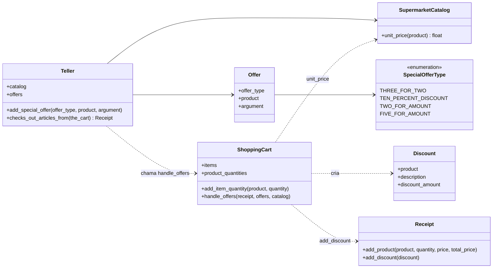
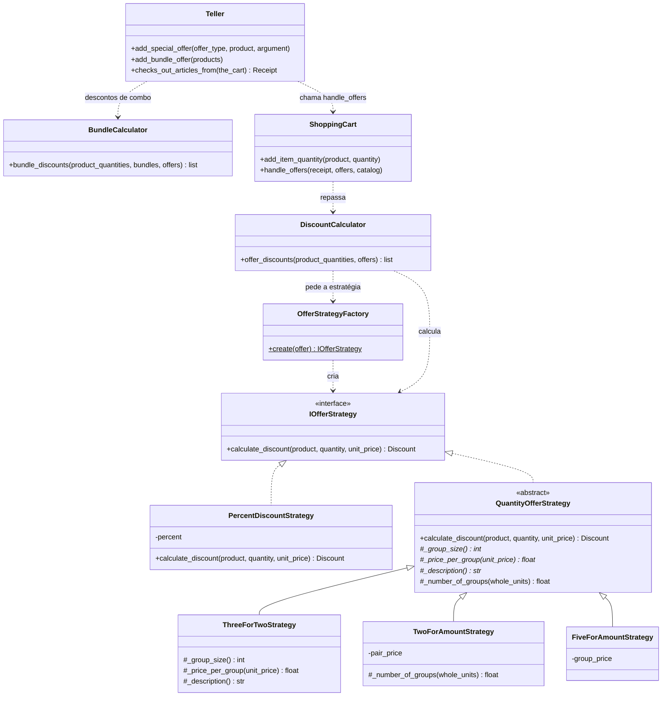

# Padrões de projeto

Projeto: Supermarket Receipt, versão python_pytest.

## 1. Resumo

O trabalho aplica dois padrões de projeto: Strategy e Template Method. Uma fábrica simples
completa o Strategy, escolhendo a estratégia de cada oferta. Cada um resolve um problema
apontado no diagnóstico (`docs/diagnostico_tecnico.md`).

| Padrão | Onde | Problema resolvido | Testes |
|---|---|---|---|
| Strategy | `src/offer_strategies.py`: interface `IOfferStrategy` e uma classe por oferta | D1 (um método decide todas as ofertas com `if` e `elif`), D2 (a mesma oferta espalhada no método) e D6 (o valor `argument` com vários significados) | `tests/test_estrategias_oferta.py` |
| Template Method | `src/offer_strategies.py`: classe base `QuantityOfferStrategy` | D3 (a mesma conta copiada nas três ofertas por quantidade) | `tests/test_estrategias_oferta.py` |
| Fábrica simples (apoio ao Strategy) | `src/offer_strategy_factory.py`: `OfferStrategyFactory` | o resto do D1: a escolha da classe de cada oferta saiu do carrinho | `tests/test_fabrica_ofertas.py` |

## 2. Diagrama de classes antes

Diagrama simplificado do código original (commit c72d68a), só com as classes que participam do
cálculo dos descontos. Os trechos de "antes" deste documento também são desse commit.



Setas cheias indicam que uma classe guarda a outra como atributo. Setas tracejadas indicam que uma
classe usa a outra.

O ponto central é o `ShoppingCart`. Além de guardar os itens da compra, o método
`handle_offers` calcula o desconto de todas as ofertas, decidindo o cálculo com uma sequência de
`if` e `elif` sobre o `SpecialOfferType`. Toda oferta nova obrigaria a mexer nesse método.

## 3. Strategy

### 3.1 Problema

No código original, o método `handle_offers` (`src/shopping_cart.py`, linhas 30 a 68) decidia o
cálculo de todas as ofertas:

```python
def handle_offers(self, receipt, offers, catalog):
    for p in self._product_quantities.keys():
        quantity = self._product_quantities[p]
        if p in offers.keys():
            offer = offers[p]
            unit_price = catalog.unit_price(p)
            quantity_as_int = int(quantity)
            discount = None
            x = 1
            if offer.offer_type == SpecialOfferType.THREE_FOR_TWO:
                x = 3

            elif offer.offer_type == SpecialOfferType.TWO_FOR_AMOUNT:
                x = 2
                if quantity_as_int >= 2:
                    total = offer.argument * (quantity_as_int / x) + quantity_as_int % 2 * unit_price
                    discount_n = unit_price * quantity - total
                    discount = Discount(p, "2 for " + str(offer.argument), -discount_n)

            if offer.offer_type == SpecialOfferType.FIVE_FOR_AMOUNT:
                x = 5

            number_of_x = math.floor(quantity_as_int / x)
            if offer.offer_type == SpecialOfferType.THREE_FOR_TWO and quantity_as_int > 2:
                discount_amount = quantity * unit_price - (
                            (number_of_x * 2 * unit_price) + quantity_as_int % 3 * unit_price)
                discount = Discount(p, "3 for 2", -discount_amount)

            if offer.offer_type == SpecialOfferType.TEN_PERCENT_DISCOUNT:
                discount = Discount(p, str(offer.argument) + "% off",
                                    -quantity * unit_price * offer.argument / 100.0)

            if offer.offer_type == SpecialOfferType.FIVE_FOR_AMOUNT and quantity_as_int >= 5:
                discount_total = unit_price * quantity - (
                            offer.argument * number_of_x + quantity_as_int % 5 * unit_price)
                discount = Discount(p, str(x) + " for " + str(offer.argument), -discount_total)

            if discount:
                receipt.add_discount(discount)
```

Os problemas:

- todas as ofertas são decididas no mesmo método (D1). Uma oferta nova, como os combos, exigiria
  editar esse método e arriscaria quebrar as outras;
- a mesma oferta aparece em pedaços separados: o "leve 3, pague 2" está no começo e no meio do
  método (D2);
- `offer.argument` é o percentual numa oferta, o preço do par em outra e o preço do grupo de
  cinco em outra (D6);
- não dá para testar uma oferta sozinha: é preciso montar catálogo, caixa, carrinho e recibo.

### 3.2 Solução

Strategy: cada forma de calcular o desconto fica numa classe própria, e todas seguem o mesmo
contrato. Quem usa as ofertas não precisa saber como cada uma calcula; só chama o método do
contrato. É a mesma ideia do exemplo visto em aula com a interface `IDesconto`.

O contrato é a interface `IOfferStrategy`, escrita no estilo das aulas, com `abc.ABC` e
`@abc.abstractmethod`:

```python
class IOfferStrategy(abc.ABC):
    """Regra de desconto de um tipo de oferta."""

    @abc.abstractmethod
    def calculate_discount(self, product: Product, quantity: float, unit_price: float) -> Discount | None:
        """Devolve o desconto do produto, ou None quando a oferta não dá desconto."""
```

Cada oferta é uma classe que segue esse contrato:

| Classe | Oferta | Valor que recebe |
|---|---|---|
| `ThreeForTwoStrategy` | leve 3, pague 2 | nenhum |
| `PercentDiscountStrategy` | desconto percentual | `percent` |
| `TwoForAmountStrategy` | 2 por um valor | `pair_price`, o preço do par |
| `FiveForAmountStrategy` | 5 por um valor | `group_price`, o preço do grupo de cinco |

O valor de cada oferta ganhou um nome claro dentro da sua classe, o que resolve o D6. A classe
`Offer` continua com o atributo `argument`, porque ele faz parte da interface pública.

### 3.3 Depois

O cálculo saiu do carrinho. O `handle_offers` continua existindo, com o mesmo nome e os mesmos
parâmetros, e só repassa o trabalho para a calculadora:

```python
def handle_offers(self, receipt: Receipt, offers: dict[Product, Offer], catalog: SupermarketCatalog) -> None:
    for discount in DiscountCalculator(catalog).offer_discounts(self._product_quantities, offers):
        receipt.add_discount(discount)
```

A calculadora pede a estratégia de cada oferta e chama o contrato, sem saber qual oferta é:

```python
for product, quantity in product_quantities.items():
    if product in offers:
        unit_price = self._catalog.unit_price(product)
        strategy = OfferStrategyFactory.create(offers[product])
        if strategy:
            discount = strategy.calculate_discount(product, quantity, unit_price)
            if discount:
                discounts.append(discount)
```

### 3.4 Benefício

- Cada oferta está inteira na sua classe (D2 resolvido).
- Nenhuma decisão por tipo de oferta ficou no carrinho nem na calculadora (D1 resolvido, com a
  fábrica da seção 5).
- Cada oferta pode ser testada sozinha, sem caixa, carrinho nem recibo. Exemplo de
  `tests/test_estrategias_oferta.py`:

```python
@pytest.mark.parametrize(
    "quantidade, desconto_esperado",
    [
        (3, -0.99),
        (7, -1.98),
    ],
)
def test_leve_3_pague_2(quantidade, desconto_esperado):
    desconto = ThreeForTwoStrategy().calculate_discount(ESCOVA, quantidade, 0.99)

    assert desconto.product is ESCOVA
    assert desconto.description == "3 for 2"
    assert desconto.discount_amount == pytest.approx(desconto_esperado)
```

## 4. Template Method

### 4.1 Problema

As três ofertas por quantidade ("leve 3, pague 2", "2 por valor" e "5 por valor") calculavam o
desconto com a mesma conta, escrita três vezes no código original, cada vez com os seus números
(D3):

```python
# 2 por valor (linha 45)
total = offer.argument * (quantity_as_int / x) + quantity_as_int % 2 * unit_price

# leve 3, pague 2 (linhas 54 e 55)
discount_amount = quantity * unit_price - (
            (number_of_x * 2 * unit_price) + quantity_as_int % 3 * unit_price)

# 5 por valor (linhas 63 e 64)
discount_total = unit_price * quantity - (
            offer.argument * number_of_x + quantity_as_int % 5 * unit_price)
```

A conta é sempre a mesma:

> desconto = quantidade × preço − (preço do grupo × número de grupos + unidades que sobram × preço)

Uma correção feita numa cópia não valeria para as outras. O defeito D12 nasceu justamente de uma
das cópias ser diferente.

### 4.2 Solução

Template Method: a conta fica escrita uma vez, numa classe base, com lacunas que cada oferta
preenche. A classe base `QuantityOfferStrategy` tem o roteiro fixo no método
`calculate_discount`:

```python
def calculate_discount(self, product: Product, quantity: float, unit_price: float) -> Discount | None:
    whole_units = int(quantity)
    if whole_units < self._group_size():
        return None
    price_with_offer = (self._price_per_group(unit_price) * self._number_of_groups(whole_units)
                        + whole_units % self._group_size() * unit_price)
    discount_amount = quantity * unit_price - price_with_offer
    return Discount(product, self._description(), -discount_amount)
```

As lacunas são os métodos que cada oferta escreve:

| Lacuna | Leve 3, pague 2 | 2 por valor | 5 por valor |
|---|---|---|---|
| `_group_size()`: tamanho do grupo | 3 | 2 | 5 |
| `_price_per_group()`: preço de um grupo completo | 2 × preço da unidade | `pair_price` | `group_price` |
| `_description()`: texto no recibo | `3 for 2` | `2 for` e o valor | `5 for` e o valor |
| `_number_of_groups()`: quantos grupos | padrão da classe base | trocado (D12) | padrão da classe base |

As três primeiras lacunas são obrigatórias (`@abc.abstractmethod`). A quarta tem um padrão na
classe base, que conta os grupos inteiros, e só o "2 por valor" troca. O `_` no início dos
nomes indica que são passos internos: quem usa as ofertas continua chamando só
`calculate_discount`.

### 4.3 Depois

O "leve 3, pague 2" ficou assim, sem nenhuma conta:

```python
class ThreeForTwoStrategy(QuantityOfferStrategy):
    """Leve 3, pague 2 (RF06)."""

    def _group_size(self) -> int:
        return THREE_FOR_TWO_GROUP_SIZE

    def _price_per_group(self, unit_price: float) -> float:
        return THREE_FOR_TWO_PAID_UNITS * unit_price

    def _description(self) -> str:
        return "3 for 2"
```

O "2 por valor" e o "5 por valor" ficaram no mesmo formato. A conta existe só na classe base, e o
D3 está resolvido. As classes novas foram comparadas com as anteriores em 8.448 casos, com
frações e preços variados, e deram exatamente os mesmos números.

### 4.4 Defeitos mantidos

A equipe decidiu manter os defeitos de cálculo do código original (plano de contingência, seção
3.1). Com a conta num lugar só, eles ficaram fáceis de apontar:

- D12 ("2 por valor" cobra a mais com quantidade ímpar): está inteiro no método
  `_number_of_groups` de `TwoForAmountStrategy`, que conta os pares com divisão comum. A correção
  seria apagar esse método, para valer a contagem de grupos inteiros da classe base;
- D13 (fração de peso não é cobrada): está numa linha da classe base, porque os grupos e a sobra
  usam as unidades inteiras e o preço sem oferta usa a quantidade completa.

### 4.5 Benefício

Uma oferta nova do mesmo tipo só preenche as lacunas, sem escrever conta. O arquivo
`tests/test_estrategias_oferta.py` mostra isso com uma oferta inventada só para o teste, "4 por
6,00":

```python
class QuatroPorSeis(QuantityOfferStrategy):
    """Oferta inventada só para o teste: 4 unidades por 6,00."""

    def _group_size(self):
        return 4

    def _price_per_group(self, unit_price):
        return 6.0

    def _description(self):
        return "4 for 6.0"
```

Com 4 unidades a 1,79, o desconto é de 1,16, e abaixo de 4 unidades não há desconto. Nenhuma
oferta existente precisou mudar (RNF04).

## 5. Fábrica simples

Depois do Strategy, faltava tirar do carrinho a escolha da classe de cada oferta. A classe
`OfferStrategyFactory` faz essa escolha com uma tabela, um dicionário que diz, para cada tipo de
oferta, como criar a estratégia a partir do valor cadastrado:

```python
_STRATEGY_BUILDERS: dict[SpecialOfferType, Callable[[float], IOfferStrategy]] = {
    SpecialOfferType.THREE_FOR_TWO: lambda argument: ThreeForTwoStrategy(),
    SpecialOfferType.TEN_PERCENT_DISCOUNT: lambda argument: PercentDiscountStrategy(argument),
    SpecialOfferType.TWO_FOR_AMOUNT: lambda argument: TwoForAmountStrategy(argument),
    SpecialOfferType.FIVE_FOR_AMOUNT: lambda argument: FiveForAmountStrategy(argument),
}
```

Uma oferta nova passa a ser uma linha nova na tabela. Um tipo de oferta desconhecido não gera
desconto, como no código original.

O enunciado cita o Factory Method como exemplo. A nossa classe é uma fábrica simples, e é
documentada com esse nome. O Factory Method do catálogo de padrões é outra coisa: uma classe base
declara o método de criação e as subclasses decidem qual objeto criar. Por isso os dois padrões
do trabalho são o Strategy e o Template Method, e a fábrica aparece como apoio ao Strategy.

## 6. Diagrama de classes depois

Diagrama simplificado do código modernizado, com as classes do cálculo dos descontos e dos
combos:



Como ler o diagrama:

- a seta com triângulo vazado e linha tracejada (`IOfferStrategy` para `PercentDiscountStrategy`
  e `QuantityOfferStrategy`) indica que a classe segue a interface. É o Strategy;
- a seta com triângulo vazado e linha cheia (`QuantityOfferStrategy` para as três ofertas por
  quantidade) indica herança. É o Template Method: as três herdam o roteiro da classe base;
- os métodos em itálico são abstratos, ou seja, as lacunas obrigatórias que cada oferta precisa
  escrever. O método sublinhado (`create`) é estático;
- as setas tracejadas simples indicam que uma classe usa a outra.

Comparando com o diagrama de antes, o `ShoppingCart` deixou de calcular as ofertas. Cada regra
ficou numa classe, a escolha da regra ficou na fábrica, e o cálculo da compra ficou nas
calculadoras. Os combos, que são a regra nova, entraram com a `BundleCalculator`, sem alterar
nenhuma classe das ofertas.

## 7. Princípios SOLID

| Princípio | Onde aparece |
|---|---|
| Responsabilidade Única | o carrinho só guarda itens, a calculadora calcula, e cada estratégia cuida de uma oferta |
| Aberto/Fechado | uma oferta nova é uma classe nova e uma linha na tabela da fábrica, sem mexer no carrinho nem nas outras ofertas. A oferta inventada "4 por 6,00" dos testes mostra isso |
| Inversão de Dependência | a calculadora depende do contrato `IOfferStrategy`, não das classes concretas, e recebe o catálogo pelo construtor. Nos testes, recebe o catálogo de teste |

## 8. Testes relacionados

| Arquivo | O que mostra |
|---|---|
| `tests/test_estrategias_oferta.py` | as quatro ofertas testadas sozinhas, sem caixa, carrinho nem recibo; a interface e a classe base não podem ser criadas sozinhas; as três ofertas por quantidade usam a mesma classe base; a oferta inventada "4 por 6,00" funciona só preenchendo as lacunas |
| `tests/test_fabrica_ofertas.py` | cada tipo de oferta gera a classe certa; o valor cadastrado chega à estratégia; um tipo desconhecido não gera estratégia |
| `tests/test_calculadora_descontos.py` | a calculadora usa as estratégias na ordem dos produtos, sem caixa, carrinho nem recibo |
| `tests/test_comportamento_legado.py` | os 40 testes de caracterização, escritos sobre o código original, passam sem nenhuma alteração depois da aplicação dos padrões |

O registro de cada etapa, com os commits, está em `docs/registro_refatoracao.md`, seções 6
(Strategy), 7 (Template Method) e 8 (fábrica simples).
