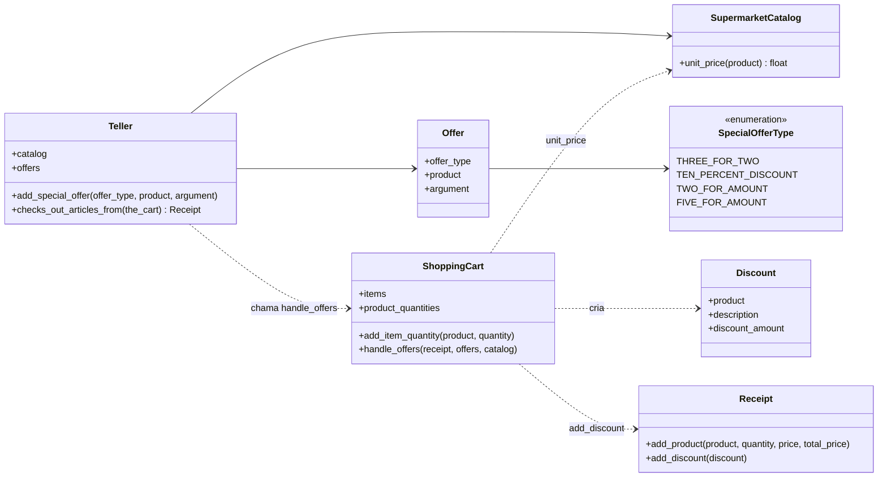

# Padrões de projeto

Projeto: Supermarket Receipt, versão python_pytest.

## 1. Resumo

O trabalho aplica dois padrões de projeto: Strategy e Template Method. Uma fábrica simples complementa o Strategy, escolhendo a estratégia de cada oferta. Cada padrão resolve problemas identificados no diagnóstico técnico (`docs/diagnostico_tecnico.md`).

| Padrão | Onde | Problema resolvido | Testes |
|---|---|---|---|
| Strategy | `src/offer_strategies.py`: interface `IOfferStrategy` e uma classe por oferta | D1 (um método decide todas as ofertas com `if` e `elif`), D2 (a mesma oferta espalhada no método) e D6 (o valor `argument` com vários significados) | `tests/test_estrategias_oferta.py` |
| Template Method | `src/offer_strategies.py`: classe base `QuantityOfferStrategy` | D3 (a mesma conta copiada nas três ofertas por quantidade) | `tests/test_estrategias_oferta.py` |
| Fábrica simples (apoio ao Strategy) | `src/offer_strategy_factory.py`: `OfferStrategyFactory` | o restante do D1: a escolha da classe de cada oferta saiu do carrinho | `tests/test_fabrica_ofertas.py` |

## 2. Diagrama de classes antes

Diagrama simplificado do código original (commit c72d68a), considerando apenas as classes que participam do cálculo dos descontos. Os trechos de código anteriores à modernização apresentados neste documento também correspondem a esse commit.



Setas cheias indicam que uma classe guarda a outra como atributo. Setas tracejadas indicam que uma classe utiliza a outra.

O ponto central é o `ShoppingCart`. Além de guardar os itens da compra, o método `handle_offers` calcula os descontos de todas as ofertas, decidindo o cálculo por meio de uma sequência de `if` e `elif` sobre o `SpecialOfferType`. A inclusão de uma nova oferta exige alterações nesse método.

## 3. Strategy

### 3.1 Problema

No código original, o método `handle_offers` (`src/shopping_cart.py`, linhas 30 a 68) decidia o cálculo de todas as ofertas:

```python
def handle_offers(self, receipt, offers, catalog):
    for p in self._product_quantities.keys():
        quantity = self._product_quantities[p]
        if p in offers.keys():
            offer = offers[p]
            unit_price = catalog.unit_price(p)
            quantity_as_int = int(quantity)
            discount = None
            x = 1
            if offer.offer_type == SpecialOfferType.THREE_FOR_TWO:
                x = 3

            elif offer.offer_type == SpecialOfferType.TWO_FOR_AMOUNT:
                x = 2
                if quantity_as_int >= 2:
                    total = offer.argument * (quantity_as_int / x) + quantity_as_int % 2 * unit_price
                    discount_n = unit_price * quantity - total
                    discount = Discount(p, "2 for " + str(offer.argument), -discount_n)

            if offer.offer_type == SpecialOfferType.FIVE_FOR_AMOUNT:
                x = 5

            number_of_x = math.floor(quantity_as_int / x)
            if offer.offer_type == SpecialOfferType.THREE_FOR_TWO and quantity_as_int > 2:
                discount_amount = quantity * unit_price - (
                            (number_of_x * 2 * unit_price) + quantity_as_int % 3 * unit_price)
                discount = Discount(p, "3 for 2", -discount_amount)

            if offer.offer_type == SpecialOfferType.TEN_PERCENT_DISCOUNT:
                discount = Discount(p, str(offer.argument) + "% off",
                                    -quantity * unit_price * offer.argument / 100.0)

            if offer.offer_type == SpecialOfferType.FIVE_FOR_AMOUNT and quantity_as_int >= 5:
                discount_total = unit_price * quantity - (
                            offer.argument * number_of_x + quantity_as_int % 5 * unit_price)
                discount = Discount(p, str(x) + " for " + str(offer.argument), -discount_total)

            if discount:
                receipt.add_discount(discount)
```

Os problemas identificados são:

- Todas as ofertas são decididas no mesmo método (D1). A inclusão de uma nova oferta exigiria editar esse método, aumentando o risco de alterações afetarem os cálculos existentes.
- A mesma oferta aparece em partes separadas do método. O cálculo de "leve 3, pague 2", por exemplo, está dividido entre o início e o meio do código (D2).
- `offer.argument` representa valores diferentes conforme a oferta: percentual de desconto, preço do par ou preço do grupo de cinco unidades (D6).
- Não é possível testar uma oferta isoladamente sem montar catálogo, caixa, carrinho e recibo.

### 3.2 Solução

Strategy: cada forma de calcular o desconto fica numa classe própria, e todas seguem um contrato comum. Quem utiliza as ofertas não precisa conhecer os detalhes de cada cálculo; basta chamar o método definido pela interface.

O contrato é a interface `IOfferStrategy`, que utiliza `abc.ABC` e `@abc.abstractmethod` para definir o método obrigatório:

```python
class IOfferStrategy(abc.ABC):
    """Regra de desconto de um tipo de oferta."""

    @abc.abstractmethod
    def calculate_discount(self, product: Product, quantity: float, unit_price: float) -> Discount | None:
        """Devolve o desconto do produto, ou None quando a oferta não dá desconto."""
```

Cada oferta é representada por uma classe que implementa esse contrato:

| Classe | Oferta | Valor que recebe |
|---|---|---|
| `ThreeForTwoStrategy` | leve 3, pague 2 | nenhum |
| `PercentDiscountStrategy` | desconto percentual | `percent` |
| `TwoForAmountStrategy` | 2 por um valor | `pair_price`, o preço do par |
| `FiveForAmountStrategy` | 5 por um valor | `group_price`, o preço do grupo de cinco |

O valor de cada oferta recebe um nome específico dentro da sua classe, eliminando a ambiguidade do D6. A classe `Offer` mantém o atributo `argument`, pois ele faz parte da interface pública existente.

### 3.3 Depois

O cálculo dos descontos foi retirado do carrinho. O método `handle_offers` continua existindo, com o mesmo nome e os mesmos parâmetros, mas agora repassa o trabalho para a calculadora:

```python
def handle_offers(self, receipt: Receipt, offers: dict[Product, Offer], catalog: SupermarketCatalog) -> None:
    for discount in DiscountCalculator(catalog).offer_discounts(self._product_quantities, offers):
        receipt.add_discount(discount)
```

A calculadora solicita a estratégia correspondente a cada oferta e chama o método definido pelo contrato, sem precisar conhecer os detalhes de cada implementação:

```python
for product, quantity in product_quantities.items():
    if product in offers:
        unit_price = self._catalog.unit_price(product)
        strategy = OfferStrategyFactory.create(offers[product])
        if strategy:
            discount = strategy.calculate_discount(product, quantity, unit_price)
            if discount:
                discounts.append(discount)
```

### 3.4 Benefício

- Cada oferta tem seu cálculo concentrado em uma classe própria (D2 resolvido).
- A decisão por tipo de oferta foi retirada do carrinho e da calculadora (D1 resolvido, com o apoio da fábrica).
- Cada oferta pode ser testada isoladamente, sem a necessidade de montar caixa, carrinho ou recibo.

O arquivo `tests/test_estrategias_oferta.py` apresenta, por exemplo, o teste da oferta "leve 3, pague 2":

```python
@pytest.mark.parametrize(
    "quantidade, desconto_esperado",
    [
        (3, -0.99),
        (7, -1.98),
    ],
)
def test_leve_3_pague_2(quantidade, desconto_esperado):
    desconto = ThreeForTwoStrategy().calculate_discount(ESCOVA, quantidade, 0.99)

    assert desconto.product is ESCOVA
    assert desconto.description == "3 for 2"
    assert desconto.discount_amount == pytest.approx(desconto_esperado)
```

## 4. Template Method

### 4.1 Problema

As três ofertas por quantidade ("leve 3, pague 2", "2 por valor" e "5 por valor") realizavam o cálculo do desconto de maneira semelhante, com a mesma estrutura de conta repetida em três partes do código original (D3):

```python
# 2 por valor (linha 45)
total = offer.argument * (quantity_as_int / x) + quantity_as_int % 2 * unit_price

# leve 3, pague 2 (linhas 54 e 55)
discount_amount = quantity * unit_price - (
            (number_of_x * 2 * unit_price) + quantity_as_int % 3 * unit_price)

# 5 por valor (linhas 63 e 64)
discount_total = unit_price * quantity - (
            offer.argument * number_of_x + quantity_as_int % 5 * unit_price)
```

A estrutura geral do cálculo é:

> desconto = quantidade × preço − (preço do grupo × número de grupos + unidades que sobram × preço)

A repetição dessa lógica dificulta a manutenção, pois uma correção em uma implementação não é automaticamente aplicada às demais. O defeito D12 está relacionado justamente a uma diferença entre essas implementações.

### 4.2 Solução

Template Method: a estrutura do cálculo fica concentrada em uma classe base, enquanto cada oferta implementa os métodos específicos necessários para definir suas particularidades.

A classe base `QuantityOfferStrategy` estabelece o fluxo do cálculo no método `calculate_discount`:

```python
def calculate_discount(self, product: Product, quantity: float, unit_price: float) -> Discount | None:
    whole_units = int(quantity)
    if whole_units < self._group_size():
        return None
    price_with_offer = (self._price_per_group(unit_price) * self._number_of_groups(whole_units)
                        + whole_units % self._group_size() * unit_price)
    discount_amount = quantity * unit_price - price_with_offer
    return Discount(product, self._description(), -discount_amount)
```

Os métodos específicos são implementados pelas classes derivadas:

| Método | Leve 3, pague 2 | 2 por valor | 5 por valor |
|---|---|---|---|
| `_group_size()`: tamanho do grupo | 3 | 2 | 5 |
| `_price_per_group()`: preço de um grupo completo | 2 × preço da unidade | `pair_price` | `group_price` |
| `_description()`: texto no recibo | `3 for 2` | `2 for` e o valor | `5 for` e o valor |
| `_number_of_groups()`: quantidade de grupos | padrão da classe base | sobrescrito (D12) | padrão da classe base |

Os três primeiros métodos são obrigatórios e definidos com `@abc.abstractmethod`. O quarto possui uma implementação padrão na classe base, que calcula a quantidade de grupos completos. A estratégia "2 por valor" sobrescreve esse método.

Os métodos iniciados por `_` são utilizados internamente pelas classes, enquanto quem utiliza as estratégias continua chamando apenas `calculate_discount`.

### 4.3 Depois

A implementação de "leve 3, pague 2" ficou concentrada nos métodos específicos da estratégia, sem repetir a estrutura geral do cálculo:

```python
class ThreeForTwoStrategy(QuantityOfferStrategy):
    """Leve 3, pague 2 (RF06)."""

    def _group_size(self) -> int:
        return THREE_FOR_TWO_GROUP_SIZE

    def _price_per_group(self, unit_price: float) -> float:
        return THREE_FOR_TWO_PAID_UNITS * unit_price

    def _description(self) -> str:
        return "3 for 2"
```

As estratégias "2 por valor" e "5 por valor" seguem a mesma estrutura. O cálculo principal permanece concentrado na classe base, resolvendo a duplicação identificada no D3.

As novas classes foram comparadas com as implementações anteriores em 8.448 casos, considerando quantidades fracionadas e diferentes preços. Os resultados numéricos foram iguais aos obtidos pelas implementações originais.

### 4.4 Defeitos mantidos

Os defeitos identificados no código original foram mantidos, conforme definido no plano de contingência (seção 3.1). Com o cálculo centralizado na classe base, eles podem ser identificados em pontos específicos:

- D12 ("2 por valor" cobra a mais com quantidade ímpar): está no método `_number_of_groups` de `TwoForAmountStrategy`, que conta os pares com divisão comum. A correção seria remover essa sobrescrita, utilizando a contagem de grupos inteiros da classe base;
- D13 (fração de peso não é cobrada): está na classe base, pois os grupos e as sobras utilizam as unidades inteiras, enquanto o preço sem oferta considera a quantidade completa.

### 4.5 Benefício

Uma nova oferta do mesmo tipo pode ser implementada preenchendo os métodos definidos pela classe base, sem precisar repetir a lógica do cálculo.

O arquivo `tests/test_estrategias_oferta.py` demonstra essa possibilidade com uma oferta adicional utilizada para verificar a extensão da classe base: "4 por 6,00".

```python
class QuatroPorSeis(QuantityOfferStrategy):
    """Oferta inventada só para o teste: 4 unidades por 6,00."""

    def _group_size(self):
        return 4

    def _price_per_group(self, unit_price):
        return 6.0

    def _description(self):
        return "4 for 6.0"
```

Com quatro unidades a 1,79, o desconto calculado é de 1,16. Para quantidades inferiores a quatro unidades, não há desconto. A nova implementação utiliza a estrutura existente sem alterar as estratégias das ofertas já implementadas (RNF04).

## 5. Fábrica simples

A classe `OfferStrategyFactory` centraliza a escolha da estratégia correspondente a cada tipo de oferta. Essa escolha é feita por meio de um dicionário que associa cada tipo de oferta à criação da estratégia correspondente:

```python
_STRATEGY_BUILDERS: dict[SpecialOfferType, Callable[[float], IOfferStrategy]] = {
    SpecialOfferType.THREE_FOR_TWO: lambda argument: ThreeForTwoStrategy(),
    SpecialOfferType.TEN_PERCENT_DISCOUNT: lambda argument: PercentDiscountStrategy(argument),
    SpecialOfferType.TWO_FOR_AMOUNT: lambda argument: TwoForAmountStrategy(argument),
    SpecialOfferType.FIVE_FOR_AMOUNT: lambda argument: FiveForAmountStrategy(argument),
}
```

A inclusão de um novo tipo de oferta exige adicionar sua associação à tabela de criação. Um tipo de oferta desconhecido não gera uma estratégia, mantendo o comportamento existente no código original.

O enunciado cita o Factory Method como exemplo para a seleção de estratégias. A fábrica utilizada no projeto é uma fábrica simples. Ela centraliza a criação dos objetos de estratégia, mas não implementa o padrão Factory Method, no qual uma classe base declara um método de criação e as subclasses definem qual objeto será criado.

Por isso, os padrões de projeto aplicados são Strategy e Template Method. A fábrica simples atua como mecanismo de apoio à seleção das estratégias.

## 6. Diagrama de classes depois

Diagrama simplificado do código modernizado, incluindo as classes responsáveis pelo cálculo dos descontos e dos combos:


Como interpretar o diagrama:

- A seta com triângulo vazado e linha tracejada, entre `IOfferStrategy` e `PercentDiscountStrategy` ou `QuantityOfferStrategy`, representa a implementação da interface. Essa relação corresponde ao Strategy;
- A seta com triângulo vazado e linha cheia, entre `QuantityOfferStrategy` e as três estratégias de ofertas por quantidade, representa herança. Essa relação corresponde ao Template Method;
- Os métodos em itálico representam métodos abstratos, que devem ser implementados pelas classes derivadas. O método `create` é estático;
- As setas tracejadas simples representam dependências entre classes.

Comparando os dois diagramas, o `ShoppingCart` deixou de calcular diretamente os descontos das ofertas. Cada regra de desconto passou a ser representada por uma estratégia, a escolha dessas estratégias ficou centralizada na fábrica e o cálculo foi separado em classes calculadoras.

Os combos foram implementados por meio da `BundleCalculator`, sem necessidade de alterar as classes responsáveis pelas ofertas individuais.

## 7. Princípios SOLID

| Princípio | Onde aparece |
|---|---|
| Responsabilidade Única | O carrinho é responsável por armazenar os itens, as calculadoras realizam os cálculos e cada estratégia implementa uma regra de oferta. |
| Aberto/Fechado | Uma nova oferta pode ser implementada em uma classe própria e registrada na tabela da fábrica, sem alterar o carrinho nem as estratégias existentes. A oferta adicional "4 por 6,00", utilizada nos testes, demonstra essa possibilidade. |
| Inversão de Dependência | A calculadora depende do contrato `IOfferStrategy`, em vez de depender diretamente das classes concretas. O catálogo é recebido pelo construtor, permitindo também a utilização de um catálogo de teste. |

## 8. Testes relacionados

| Arquivo | O que demonstra |
|---|---|
| `tests/test_estrategias_oferta.py` | As quatro ofertas testadas isoladamente, sem caixa, carrinho ou recibo; a interface e a classe base não podem ser instanciadas diretamente; as três ofertas por quantidade utilizam a mesma classe base; a oferta adicional "4 por 6,00" funciona com a implementação dos métodos específicos. |
| `tests/test_fabrica_ofertas.py` | Cada tipo de oferta gera a classe correspondente; o valor cadastrado é repassado à estratégia; um tipo desconhecido não gera estratégia. |
| `tests/test_calculadora_descontos.py` | A calculadora utiliza as estratégias na ordem dos produtos, sem depender de caixa, carrinho ou recibo. |
| `tests/test_comportamento_legado.py` | Os 40 testes de caracterização, escritos com base no código original, passam sem alterações após a aplicação dos padrões. |

O registro de cada etapa de desenvolvimento, incluindo os commits correspondentes, está em `docs/registro_refatoracao.md`, nas seções 6 (Strategy), 7 (Template Method) e 8 (fábrica simples).
